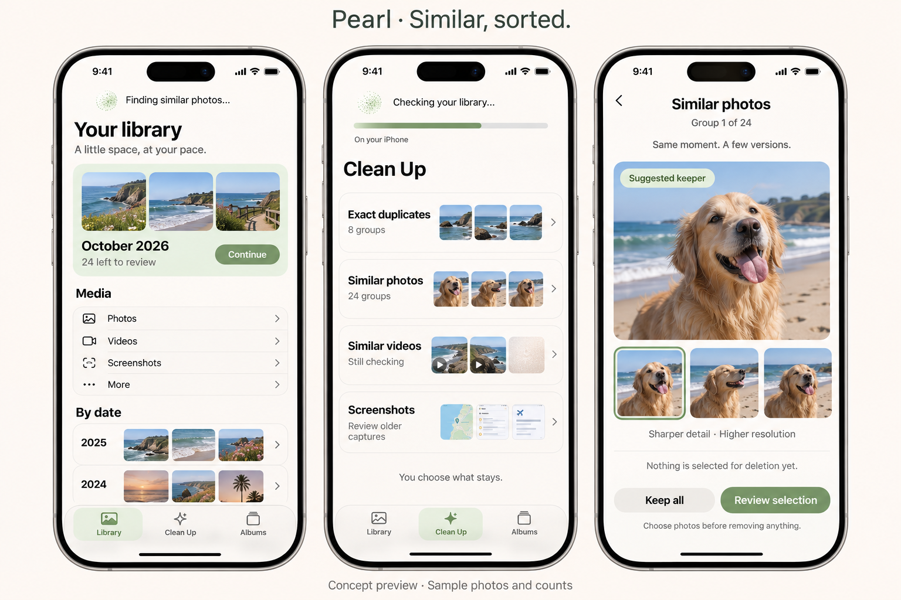
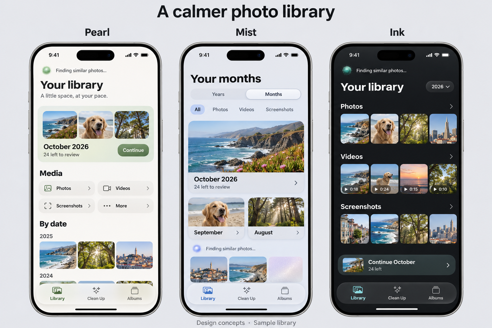

# Pearl

A calm, native iPhone app for browsing, organizing, and reviewing a large photo library in manageable pieces.

**Status: Pearl 0.1.0 built and verified for personal sideload signing.**

[Verification and IPA details](docs/VERIFICATION.md) · [Actual simulator screenshots](docs/SCREENSHOTS.md) · [First iPhone check](docs/DEVICE-CHECK.md)

The user selected the **Pearl visual direction**: warm white, sage accents, rounded shapes, generous spacing, native system glass, textured loading placeholders, and small Thinking Orbs. The first app uses Pearl as its name and `com.n3mostudio.pearl` as its bundle ID, with iOS 18 as the baseline.

Implemented: media/year/month browsing and filters; photo zoom and video playback; swipe/button review, undo, persistent choices, favorite/protection safeguards and a final review queue; album creation and batch filing; streamed exact-file hashes; on-device Vision similar-photo suggestions and five-frame video suggestions. No default deletion selection. Every deletion requires review and the system confirmation.

Analysis is local. Optional iCloud downloads go through Apple; there is no analytics, cloud AI, account, advertising or subscription. Scanning pauses when the app leaves the foreground, in Low Power Mode or serious thermal pressure. [Build, architecture and limitations](docs/BUILD.md).

## Start here

- [Feature checklist and acceptance criteria](docs/FEATURE-BACKLOG.md)
- [Product and interaction plan](docs/PRODUCT-PLAN.md)
- [Local similarity and technical groundwork](docs/TECHNICAL-PLAN.md)
- [Research: 29 products and projects](research/LANDSCAPE.md)
- [Existing-app screenshot references](research/VISUAL-REFERENCES.md)
- [Design decisions](design/DESIGN-SPEC.md)
- [Decisions and project status](docs/DECISIONS.md)

These are AI-generated concept images with sample media and counts. They do not demonstrate working scanning, performance, accessibility, or native Liquid Glass rendering.

## Workspace

Canonical local repository: `C:\Users\naith\Documents\GitHub\Photo Cleaner`, alongside Elsepin and Calc 84.

The folder is registered in GitHub Desktop's local repository list. Setup used background operations and did not take over the mouse, keyboard or active window.

Private source/build remote: [N3moStudio/Pearl](https://github.com/N3moStudio/Pearl). XcodeGen produces the native project from `project.yml`. GitHub Actions compiles the app on a Mac, runs core and simulator checks, then packages an ad-hoc IPA for personal re-signing. Signing credentials and personal media are never stored in this repository.

Research date: November 4, 2026, America/Los_Angeles. Sources are linked next to their claims. This is a broad survey, not an exhaustive census of every photo app.
