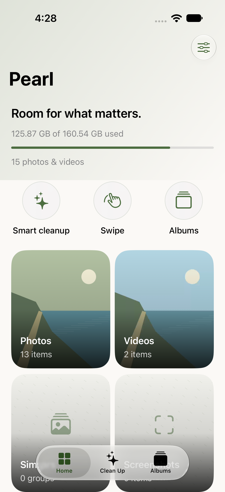
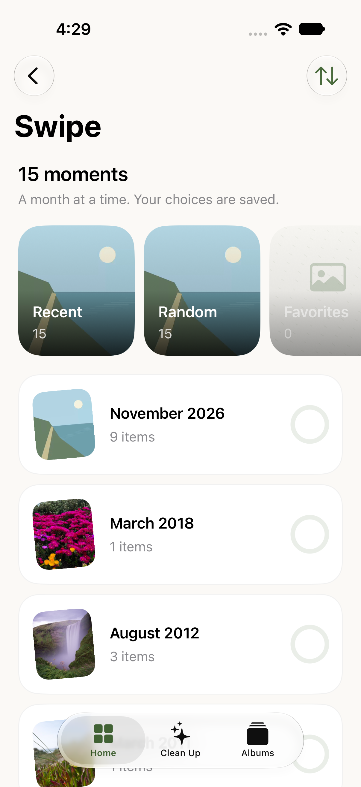
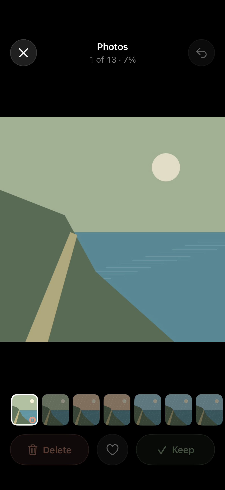
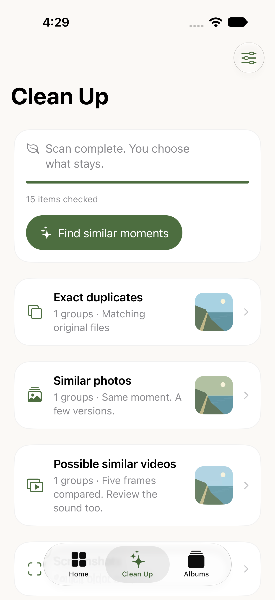
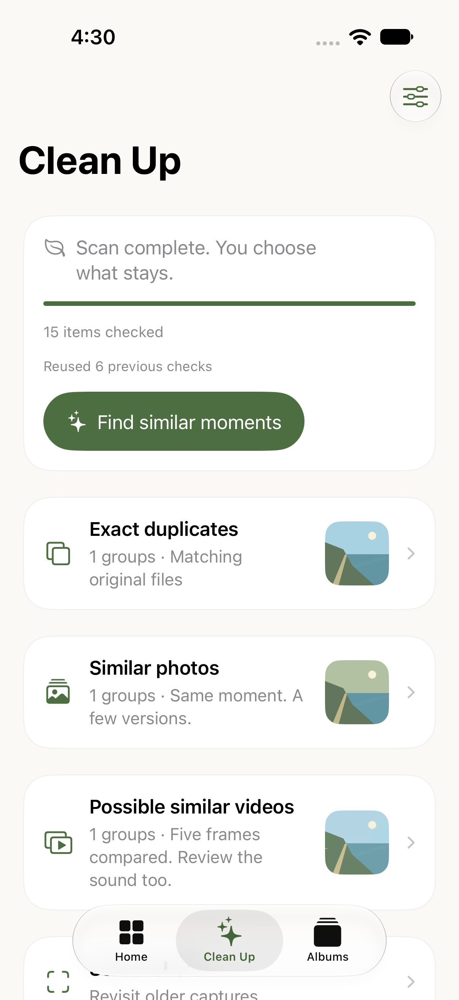
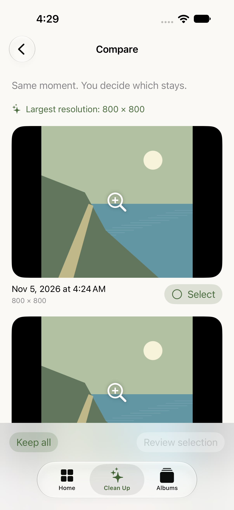

# Pearl 0.2.0 native captures

From passing simulator run 41967547298, using synthetic/stock media. They match the delivered `85036ecf` build, not the additional unbuilt polish on main. See [verification limits](VERIFICATION.md).

## Home

## Swipe by month

## Photo review

Captured during the outgoing decision transition; controls are temporarily disabled until it finishes.

## Local matching and saved recovery

## Comparison

The complete captures also include a black media-area frame during the month video/photo test, the system Home screen during the saved-background fallback, and the largest-text home layout before its pending correction. These are retained as diagnostic evidence, not proof of successful video rendering, a Live Activity, or complete accessibility acceptance.
