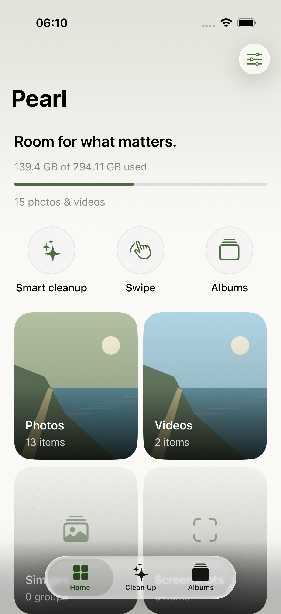
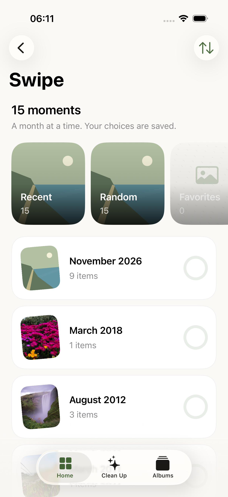
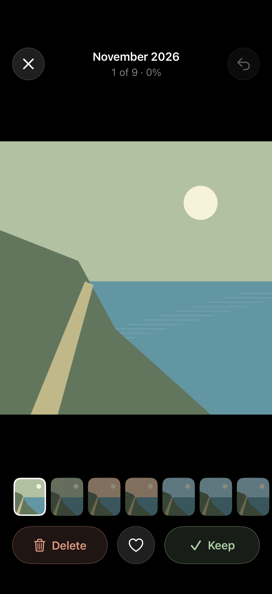
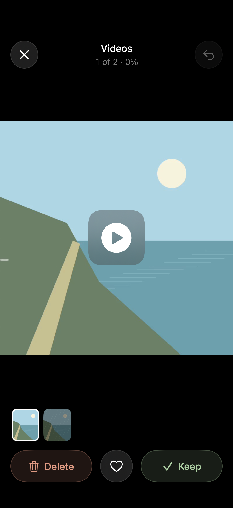
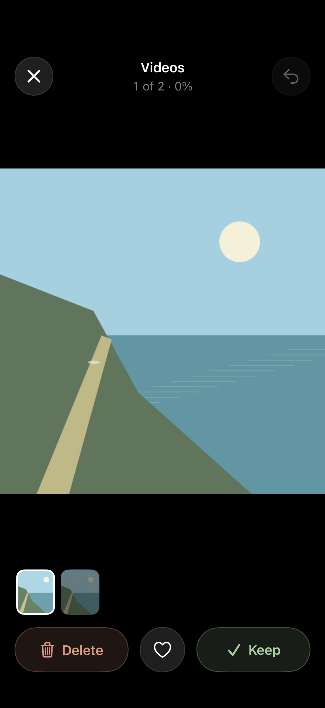
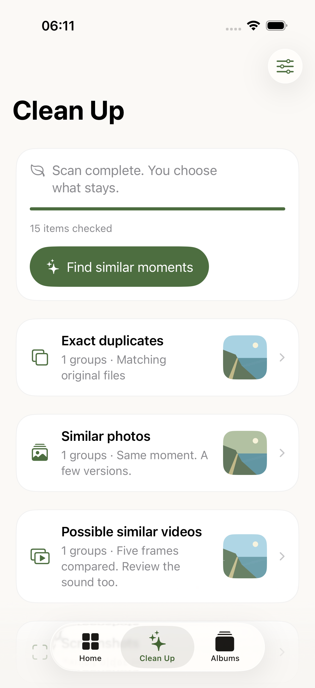
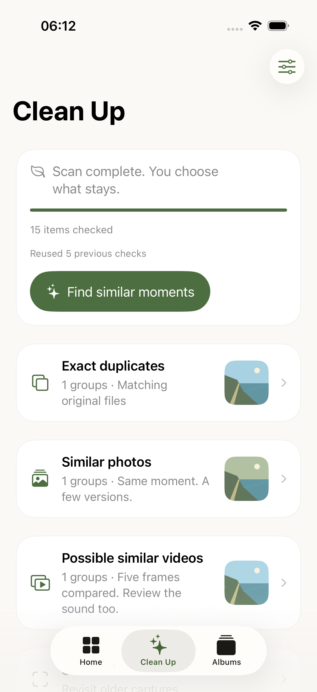
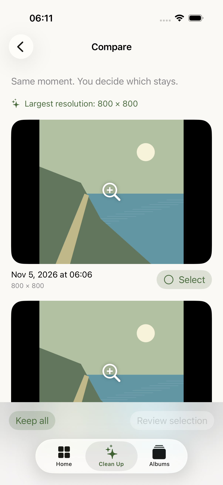
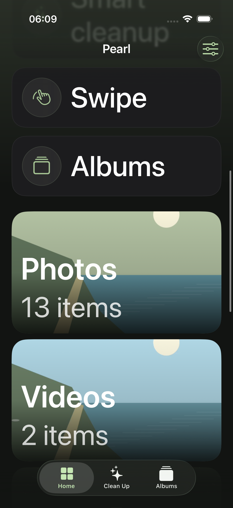

# Pearl 0.2.1 native captures

From passing [Codemagic build 3](https://codemagic.io/app/6aec14d6c73110160e3cd00e/build/6aec1ca2004ce28f20ee0ae7), source `8855a989`, using generated landscapes and simulator stock media. These are actual simulator screenshots, not concept art. See [verification and device limits](VERIFICATION-0.2.1.md).

## Home

## Swipe by month

## Full-screen photo review

Visible media after favorite changes and a partial drag. The pixel regression check passed here and after filmstrip navigation.

## Video

The poster remains until AVKit reports a displayable frame. The test checked readiness and visible media after Play, then exercised rapid navigation.

## Local matching and saved recovery

## Comparison

## Largest text in dark appearance

The home switches to vertical shortcuts and one-column media cards. This capture shows the scrolled view; it is not a full VoiceOver or physical-device accessibility audit.

Older 0.2.0 captures remain in `screenshots/0.2.0/` as historical evidence. The current background test used saved fallback, so its system Home-screen capture does not demonstrate a Live Activity.
