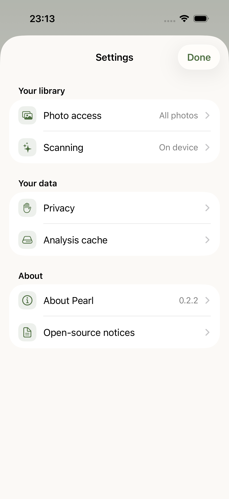
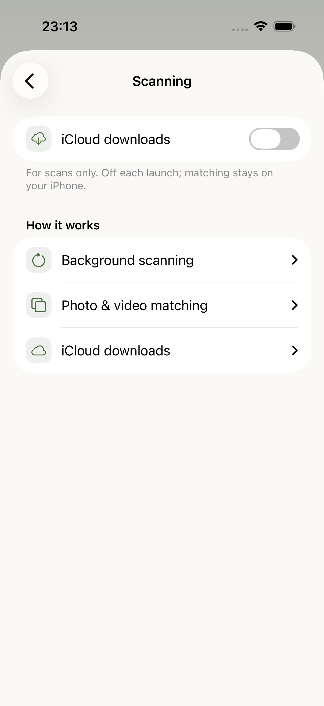
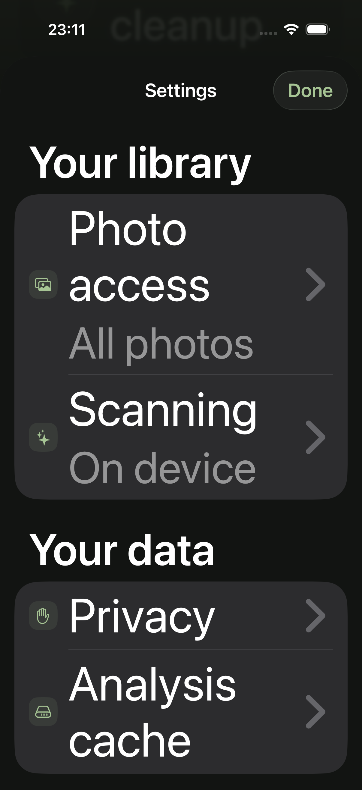

# Pearl 0.2.2 settings

Actual iPhone 17 Pro simulator captures from passing [build 5](https://codemagic.io/app/6aecf0269562a7261fedc429/build/6aee5bee24e1ec237556fd68), tested source `b1bb0ce`. These are native app captures, not concept art. [Verification and limits](VERIFICATION-0.2.2.md).

## Compact main page

All six rows fit at standard text size. The heading stays inline; detailed help is inside each relevant page.

## Scanning

The download preference is still off each launch. Background and matching details expand when requested.

## Maximum text size in dark appearance

Text wraps and values move beneath labels; decorative symbols stay within their badges. Scrolling reveals the remaining groups. This is simulator layout evidence, not a full physical-device accessibility audit.

